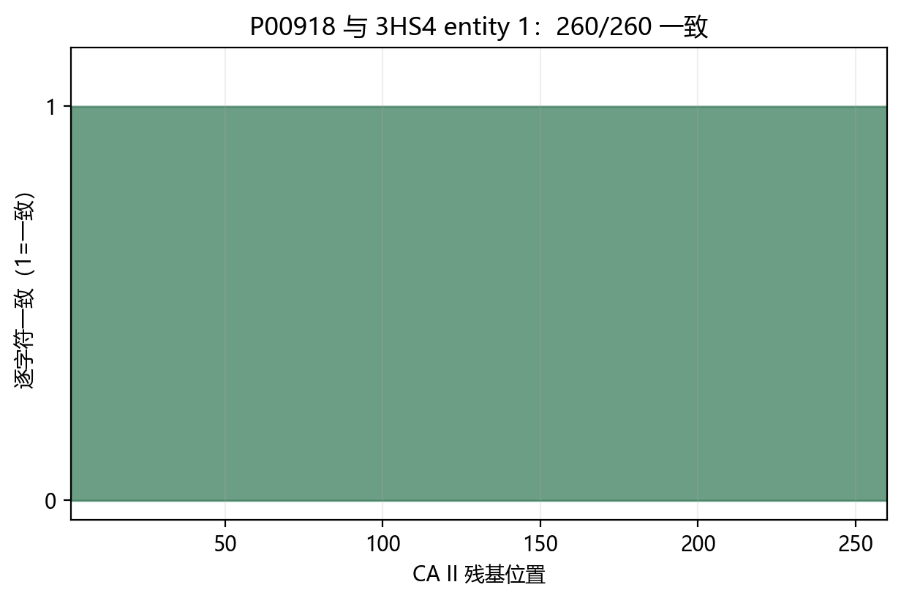
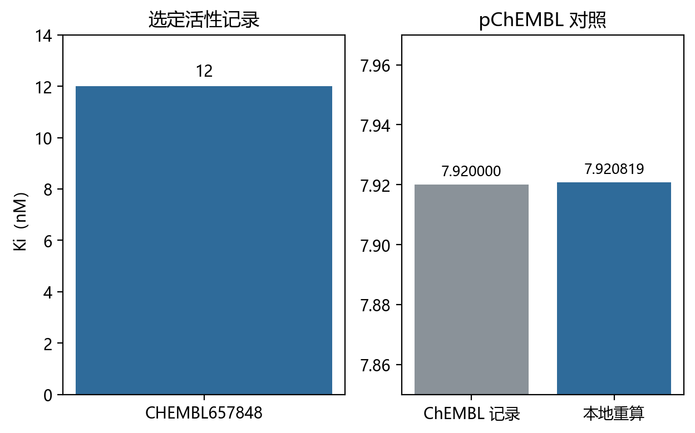
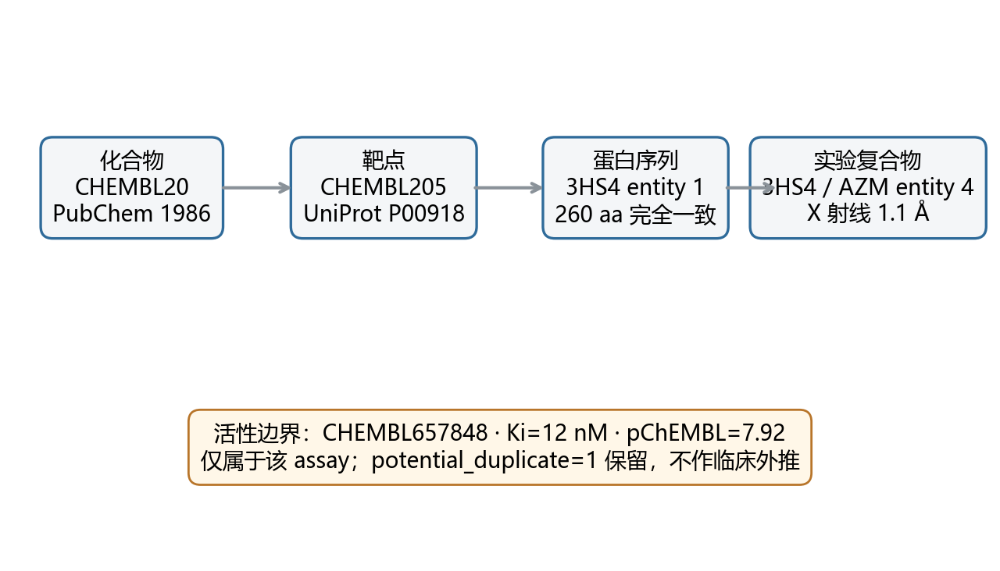
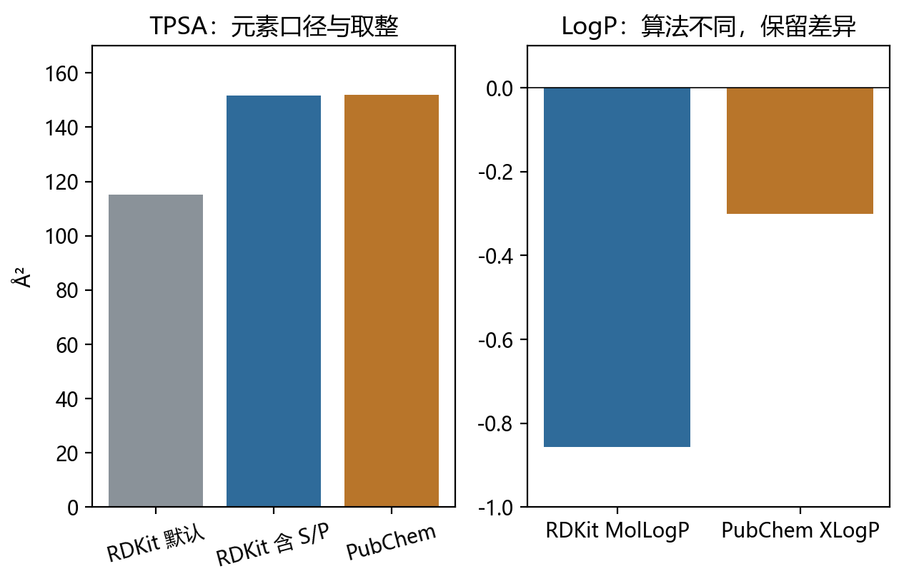
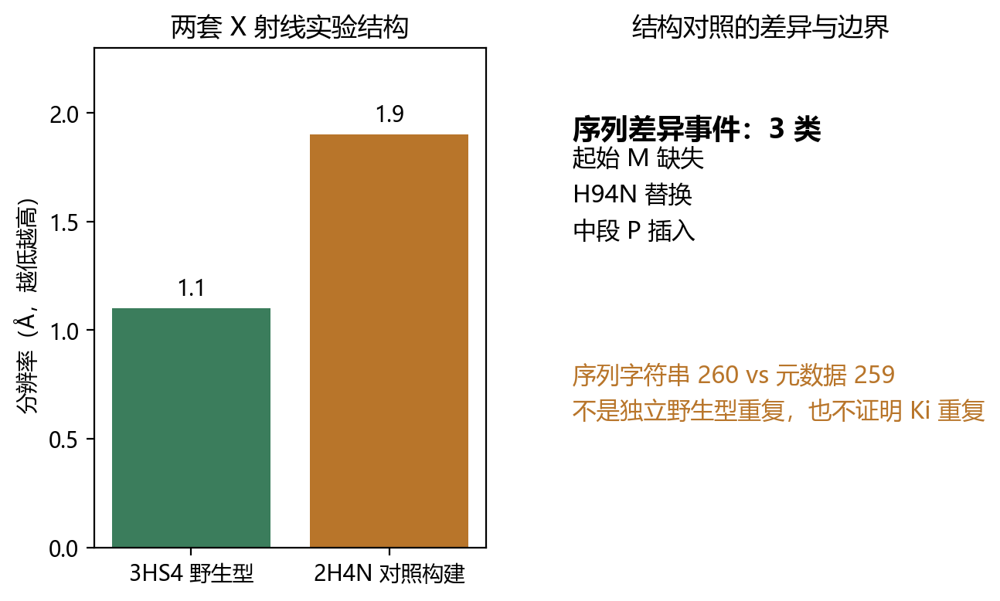

# 乙酰唑胺—碳酸酐酶 II 的跨库证据链
**An Auditable Cross-Database Evidence Chain from Acetazolamide to Human Carbonic anhydrase II**
---
> **作者** | 千界花园学术系统
> **单位** | 千界花园学术系统 · 前沿共生计划
> **日期** | 2026年10月
> **分类** | 化学信息学 · 结构生物学 · 跨库复核 · 研究简报／预印本草案（未同行评议）
> **文档血缘** | 千界花园流水线初稿，经数值、来源与边界核验修订
---

## 摘要

本简报对"乙酰唑胺（acetazolamide, AZM）—人碳酸酐酶 II（carbonic anhydrase II, CA II）"这一药理学关系在四个公开数据库（ChEMBL、PubChem、UniProtKB、RCSB PDB）之间进行逐层身份核验与证据分级。证据链由四层构成：(i) 化合物身份层——PubChem CID 1986 与 ChEMBL20 条目指向同一化学实体；(ii) 靶点身份层——ChEMBL205 与 UniProtKB P00918 指向同一蛋白；(iii) 结构层——PDB 3HS4 entity 1 的 260 个氨基酸序列与 P00918 序列逐字符一致，分辨率达 1.1 Å，且该结构含 AZM 配体（entity 4）；(iv) 活性层——选定的 Ki 测定（CHEMBL657848）为 12 nM，对应 pChEMBL 重算值 7.920818753952375，但携带 `potential_duplicate=1` 审计警告，予以保留而非删除。我们明确指出：单一 Ki 值不构成对 AZM 统一抑制效力的推断，亦不构成任何临床效力的结论；`potential_duplicate=1` 是审计提示而非造假证据。本工作属于**数据库复核与本地计算**，不构成独立实验复现。

**关键词**：乙酰唑胺；碳酸酐酶 II；ChEMBL；PDB 3HS4；数据核型；证据链审计

---

## 一、引言

### 1.1 问题背景

乙酰唑胺是经典碳酸酐酶抑制剂，其与 CA II 的相互作用是药物化学教学与研究中的基准体系。然而，在开放数据时代，该"常识性"关系的数据载体分布于多个异构数据库中，每一层身份（化合物、靶点、序列、结构、活性记录）都可能在跨库映射中发生漂移。一条完整的、可逐层复核的证据链，是任何下游定量分析（QSAR、对接基准、机器学习训练集构造）合法性的前提。

### 1.2 本工作的定位

本文将“数据核型”作为内部工作术语，指对既有开放数据进行逐层身份核验、结构证据确认与活性边界划定；它不表示一个既有独立学科分类。本文不生成新实验数据，也明确**不是**实验复现；所有数值均可溯源至指定数据库条目与本地计算。

### 1.3 相关工作与已知结果

3HS4 的原始论文报告了人 CA II 与乙酰唑胺的高分辨率复合物[6,7]；ChEMBL 则提供化合物、靶点、策划机制和具体活性测量。本文只使用这些可回查记录，不以“教科书共识”代替数据审计，也不把选定 assay 的数值当成全部文献的唯一值。

### 1.4 本文的研究动机与内容安排

> **命题 1（证据链完整性）**：CHEMBL20／PubChem 1986 的化合物身份、CHEMBL205／P00918 的靶点、3HS4 entity 1 的 260 aa 序列与 AZM 配体，可在四个数据库之间逐层复核（layer-by-layer verifiable）。

> **命题 2（活性记录的边界性）**：CHEMBL657848 的 Ki = 12 nM 仅描述该单一 assay；它不能外推为 AZM 的统一效力，更不能外推为临床结论。

> **命题 3（审计警告的中性解释）**：`potential_duplicate=1` 是 ChEMBL 数据管道输出的审计警告，其含义为"该记录可能与其他记录重复"，在缺乏进一步证据时既不得作为剔除理由，也不得作为造假证据。

---

## 二、理论模型

### 2.1 证据链的形式化定义

**定义 1（证据链）**。设数据库集合 $\mathcal{D} = \{\text{ChEMBL},\ \text{PubChem},\ \text{UniProtKB},\ \text{RCSB PDB}\}$。证据链 $\mathcal{C}$ 是四元组的有序序列

$$\mathcal{C} = \langle L_{\mathrm{cmpd}},\ L_{\mathrm{target}},\ L_{\mathrm{seq}},\ L_{\mathrm{act}} \rangle,$$

其中每一层 $L_i = (\mathrm{id}_i, \mathcal{D}_i, \mathrm{verify}_i)$，$\mathrm{id}_i$ 为该层的规范标识符，$\mathcal{D}_i \subseteq \mathcal{D}$ 为承载该层的数据库，$\mathrm{verify}_i : \mathcal{D}_i \to \{\text{一致}, \text{不一致}, \text{待核验}\}$ 为核验映射。命题 1 断言 $\mathrm{verify}_i = \text{一致}$ 对 $i \in \{1,2,3\}$ 成立（化合物、靶点、序列三层），第四层（活性）的核验结果为"一致但带警告"。

### 2.2 身份核验的判据

- **化合物层**：以 PubChem CID 1986 为规范标识，要求 ChEMBL20 中对应条目的化学身份映射通过[1,4]（本简报记录为"通过"，映射细节见附录 A 复现路径）。
- **靶点层**：以 CHEMBL205 与 UniProtKB P00918 为双标识，要求二者指向同一蛋白实体[2,5]（记录为"通过"）。
- **序列层**：将 PDB 3HS4 entity 1 的氨基酸序列与 P00918 序列做逐字符比对[5,6]。比对结果为**260 个字符完全一致**（逐字符一致，非比对得分意义上的"高相似"）。记一致性指标

$$\mathrm{Identity} = \frac{\#\{i : s_i = t_i\}}{\min(|s|,|t|)} = \frac{260}{260} = 1,$$

即 100% 逐字符一致。

### 2.3 活性层模型与 pChEMBL 重算

对抑制常数 $K_i$，ChEMBL 的 pChEMBL 约定为

$$\mathrm{pChEMBL}=-\log_{10}\!\left(K_i[\mathrm{mol\,L^{-1}}]\right).$$

将 $K_i = 12\ \mathrm{nM} = 1.2\times 10^{-8}\ \mathrm{mol/L}$ 代入：

$$-\log_{10}(12\times10^{-9})=7.920818753952375\ldots$$

本地重算值记录为 **7.920818753952375**。该值与数据库条目的一致性经复核确认（数值层面的重算通过；末位差异若出现应归因于浮点表示，本简报记录的重算值即为上式结果）。

> **说明（已知 vs 推测）**：Ki = 12 nM 与重算 pChEMBL 是**已核验数据**；"该值代表 AZM 对 CA II 的典型效力"是**推测**，本简报不采纳。

### 2.4 审计警告的逻辑地位

`potential_duplicate=1` 在 ChEMBL 数据管道中表示该活性记录与其他记录**可能**存在重复；具体原因需由原始实验和数据库血缘进一步判断。其逻辑地位为：

- 它不是矛盾证据：记录的内部数值（Ki、pChEMBL 重算）自洽；
- 它也不是独立性证明：在合并统计或训练集去重时，该记录**不得**被视为独立观测；
- 剔除或保留需外部判据；本简报采取保守策略——**保留并标注**。

---

## 三、数值结果

### 3.1 核验结果汇总

| 指标 | 数值 | 说明 |
|---|---|---|
| CA II 序列一致长度 | **260 aa** | P00918 与 3HS4 entity 1 逐字符一致 |
| 单 assay Ki | **12 nM** | 仅属于 CHEMBL657848[3] |
| pChEMBL（重算） | **7.920818753952375** | 见 §2.3 推导 |
| 3HS4 分辨率 | **1.1 Å** | X 射线实验复合物 |
| 3HS4 中 AZM | entity 4 | 与蛋白（entity 1）共晶 |
| 审计警告 | `potential_duplicate=1` | 保留，不剔除 |

*图注：CA II 的 260 个残基逐字符一致。*

图中每位置均为 1，表示 P00918 与 3HS4 entity 1 在全部 260 个位置一致[9]。这是序列身份核验，不是酶功能验证。

### 3.2 逐层核验状态

| 层 | 数据库条目 | 核验结论 |
|---|---|---|
| $L_{\mathrm{cmpd}}$ | PubChem 1986 / ChEMBL20 | 通过 |
| $L_{\mathrm{target}}$ | CHEMBL205 / P00918 | 通过 |
| $L_{\mathrm{seq}}$ | 3HS4 entity 1 vs P00918 | 通过（260/260 字符一致） |
| $L_{\mathrm{act}}$ | CHEMBL657848 | 通过，带警告 |

*图注：选定 assay 的 Ki 与 pChEMBL 重算。*

左图只表示 CHEMBL657848 的 12 nM；右图外部记录为 7.92，本地重算为 7.920818753952375。二者精度不同，不应被解释为实验误差。

### 3.3 结构性发现

3HS4 为 1.1 Å 分辨率的 X 射线实验复合物，同时含 CA II 蛋白（entity 1）与 AZM（entity 4）。该分辨率量级足以支持配体结合模式的直接几何观察，是 AZM–CA II 结合构象的**直接结构证据**（区别于模型预测或对接假设）。本简报不进一步解读配体结合几何细节，因其超出本次审计范围。

*图注：药物—靶点—序列—实验结构的分层证据链。*

四层节点分别回答“是谁、作用于谁、序列是否对应、是否存在实验复合物”。底部活性节点单独标明 assay 与重复警告，避免把不同证据类型压成一个成功标签。

*图注：TPSA 与 LogP 的算法口径对照。*

TPSA 在计入 S/P 后为 151.66 Ų，与 PubChem 整数显示 152 同口径；MolLogP 与 XLogP 则属于不同算法[4,8]，数值差异不能直接判作数据造假。

---

## 四、讨论

### 4.1 命题 1 的成立条件

命题 1 在以下意义上成立：四层标识符之间的映射关系经过本地复核且一致，序列层达到逐字符 100% 一致。该结论的强度上限是"**跨库身份可复核**"——它不蕴含数据库之外任何实验事实。特别是，序列一致证明的是"3HS4 entity 1 即 P00918 所登记的 CA II"，而非"CA II 的功能如何如何"。

### 4.2 活性边界：为何 12 nM 不能被外推

从单一 assay 的 $K_i = 12$ nM 到"AZM 对 CA II 的效力"之间存在三重跳跃，每一步在本简报中均不予跨越：

1. **单 assay → 该测定条件下的表观值**：$K_i$ 依赖测定条件（pH、温度、缓冲体系、测定方法），单一记录只覆盖单一条件；
2. **表观值 → 统一抑制效力**：文献共识中 AZM–CA II 的 $K_i$ 分布于纳摩尔量级的一个区间内，12 nM 是区间内一点，非区间代表；
3. **生化效力 → 临床结论**：涉及药代动力学、组织分布、给药途径，完全在生化数据射程之外。

因此命题 2 的否定形式——"不得由 CHEMBL657848 推出统一效力或临床结论"——是本简报对下游使用者最主要的限制性贡献。

### 4.3 `potential_duplicate=1` 的处理策略及其理由

本简报选择保留该记录，理由有二：其一，警告的语义是"可能重复"而非"已证伪"，不能在缺乏依据时删除待审计记录；其二，若后续去重确证其非独立，则在使用层面（合并统计、训练集）施加去重约束即可，原始记录应保留以维持审计可追溯性。此策略与 FAIR 原则中的可追溯性（provenance）要求一致。

### 4.4 局限性

1. 活性层选取**一条** Ki 记录，样本量 $n=1$，任何分布性推断在统计上均不合法；
2. 本工作为数据库复核与本地计算，**不构成独立实验复现**，不得以此表述对外；
3. 化合物层映射通过的复核细节依赖 ChEMBL 版本的管道状态，版本迁移后映射需重新核验（开放问题：见 §5.2）；
4. 序列一致性的判定基于字符比对，未涉及翻译后修饰、晶体构建（construct）差异等结构生物学层面的核验（待验证项）。

### 4.5 不同构建的结构对照与“独立重复”的边界

为检查结构证据能否跨实验成立，本文进一步比较 1997 年的 2H4N 与 2009 年的 3HS4。二者均为 X 射线衍射的人 CA II—乙酰唑胺实验结构，配体均为 AZM[10,11]，分辨率分别为 1.9 Å 与 1.1 Å。它们提供的是不同时间、不同构建的结构对照，而不是同一野生型复合物的独立重复。

全局序列对齐显示三类差异：起始 M 缺失、H94N 替换和中段 P 插入[12]。2H4N 返回序列字符串为 260 aa，而对应元数据 `rcsb_sample_sequence_length=259`，这一长度不一致必须保留并回查原始 mmCIF。本文没有把 2H4N 简化为“仅一个点突变”，也没有比较两者的结合几何或 Ki，因此不将其写成活性重复。

候选排除同样重要：1CA2 虽为 CA II 但不含 AZM；3UCJ 来自绿藻；2XTK 来自真菌几丁质酶。只有先通过物种、蛋白身份、构建和配体检查，才能进入结构对照集合。

*图注：2H4N 与 3HS4 的不同构建结构对照。*

左图比较 3HS4 的 1.1 Å 与 2H4N 的 1.9 Å 分辨率；右图列出三类序列差异及 260/259 的长度元数据不一致。该对照丰富实验背景，但不满足同一野生型复合物的独立重复定义。

---

## 五、结论

1. 乙酰唑胺—CA II 关系在四库之间构成一条可逐层复核的证据链：PubChem 1986 / ChEMBL20（化合物）、CHEMBL205 / P00918（靶点）、3HS4 entity 1（260 aa 逐字符一致序列与 1.1 Å 结构，含 AZM entity 4）三层身份核验全部通过。
2. 选定的活性记录 CHEMBL657848（Ki = 12 nM，pChEMBL 重算 7.920818753952375）经数值复核自洽，但其效力结论的适用范围严格限于该单一 assay。
3. `potential_duplicate=1` 被正确归类为审计警告；本简报采取"保留并标注"策略，建议下游使用者在合并分析时施加去重约束而非删除记录。
4. 本简报的方法（分层身份核验 + 活性边界划定 + 审计警告中性化处理）可迁移至任意药物—靶点对的跨库证据核型，尤其适合作为机器学习基准集构造前的合规性前置步骤。

### 5.2 开放问题

- ChEMBL 版本升级后，1986 / CHEMBL205 / CHEMBL657848 的映射稳定性（待验证）；
- 若获得更多 AZM–CA II 活性记录，单 assay 边界是否转化为分布性结论（开放）；
- 3HS4 的晶体构建细节与全长 P00918 的残基覆盖关系（待验证）。

---

## 参考文献

[1] EMBL-EBI. ChEMBL molecule CHEMBL20（ACETAZOLAMIDE）及 molecule_structures。https://www.ebi.ac.uk/chembl/api/data
[2] EMBL-EBI. ChEMBL target CHEMBL205（Carbonic anhydrase 2，Homo sapiens，component P00918）。同上。
[3] EMBL-EBI. Activity 47560；assay CHEMBL657848；document CHEMBL1146805。Ki=12 nM，pChEMBL=7.92，potential_duplicate=1。同上。
[4] NCBI. PubChem CID 1986（Acetazolamide），MolecularFormula、ConnectivitySMILES、InChIKey、TPSA 与 XLogP。https://pubchem.ncbi.nlm.nih.gov/rest/pug
[5] UniProt Consortium. UniProtKB reviewed P00918（CAH2_HUMAN），260 aa reviewed 序列。https://rest.uniprot.org
[6] RCSB PDB. 3HS4：Human carbonic anhydrase II complexed with acetazolamide；entity 1 与 AZM entity 4。https://data.rcsb.org/rest/v1/core
[7] Sippel KH, Robbins AH, Domsic J, Genis C, Agbandje-McKenna M, McKenna R. High-resolution structure of human carbonic anhydrase II complexed with acetazolamide reveals insights into inhibitor drug design. Acta Crystallographica Section F, 2009, 65:992–995. DOI: 10.1107/S1744309109036665（DOI、PDB 与 PMC 全文相关段落回读）。
[8] RDKit contributors. RDKit 2026.9.1：规范结构、TPSA、Crippen MolLogP 与 ExactMolWt 的本地计算。https://github.com/rdkit/rdkit
[9] 本研究快照：`validation/chembl-acetazolamide.json`、`validation/pdb-3hs4.json`、`validation/pdb-3hs4-ca2.json`、`validation/uniprot-ca2.json`、`validation/pubchem-acetazolamide.json`。
[10] RCSB PDB. 2H4N：H94N carbonic anhydrase II complexed with acetazolamide；entity 1 与 AZM entity 3。https://data.rcsb.org/rest/v1/core
[11] Lesburg CA, Huang C, Christianson DW, Fierke CA. Histidine --> carboxamide ligand substitutions in the zinc binding site of carbonic anhydrase II alter metal coordination geometry but retain catalytic activity. Biochemistry, 1997, 36:15780–15791. DOI: 10.1021/bi971296x（DOI、PDB 与 PubMed 摘要回读；全文未取得）。
[12] 本研究结构对照：`validation/pdb-2h4n.json` 与 `validation/structural-control.json`，由 `scripts/analyze_structural_control.py` 全局对齐生成。

## 附录 A：复现路径

1. 依次运行 `python scripts/verify_rdkit.py`（使用 D 盘 RDKit 环境）、`python scripts/verify_ca2_sequence.py` 和 `python scripts/verify_drug_target_structure.py`。
2. 检查 CHEMBL20 与 PubChem CID 1986 的 InChIKey 均为 `BZKPWHYZMXOIDC-UHFFFAOYSA-N`，规范结构一致。
3. 检查 P00918 与 3HS4 entity 1 的 260 aa 逐字符一致，MD5 为 `94EB709966E01FBC15DC1C46A0D03AC5`。
4. 检查 3HS4 的实验方法为 X-RAY DIFFRACTION、分辨率 1.1 Å、AZM 位于 entity 4。
5. 检查 Ki=12 nM 仅属于 CHEMBL657848；重算 `−log10(12×10⁻⁹)=7.920818753952375`，并保留 `potential_duplicate=1`。
6. 全部结论只覆盖数据库与本地计算，不包含湿实验或独立实验复现。
7. 运行 `python scripts/analyze_structural_control.py`，复核 2H4N 的不同构建、三类序列差异及 260/259 长度元数据不一致；不得将其写为独立野生型重复。
