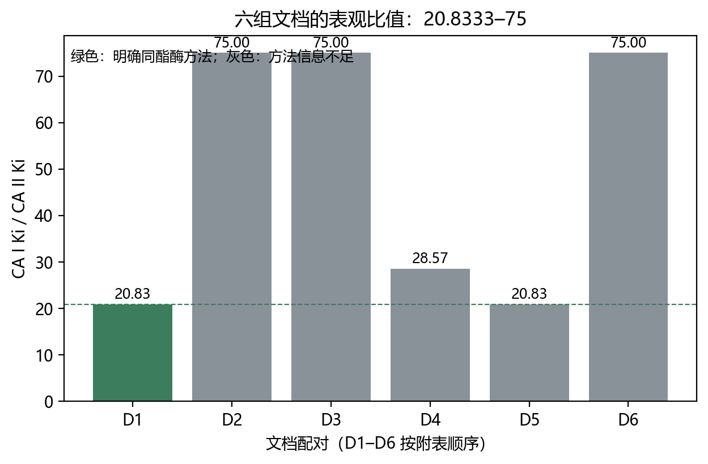
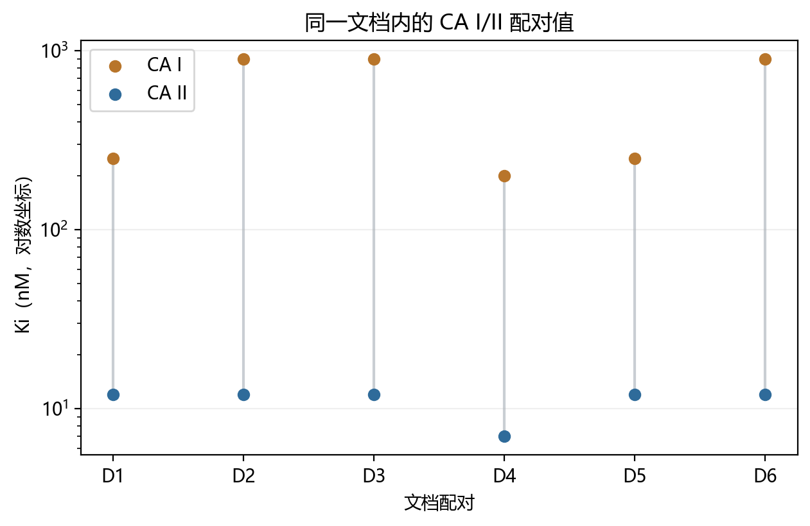
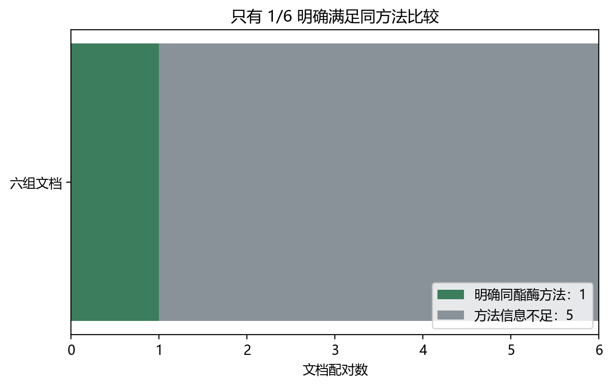
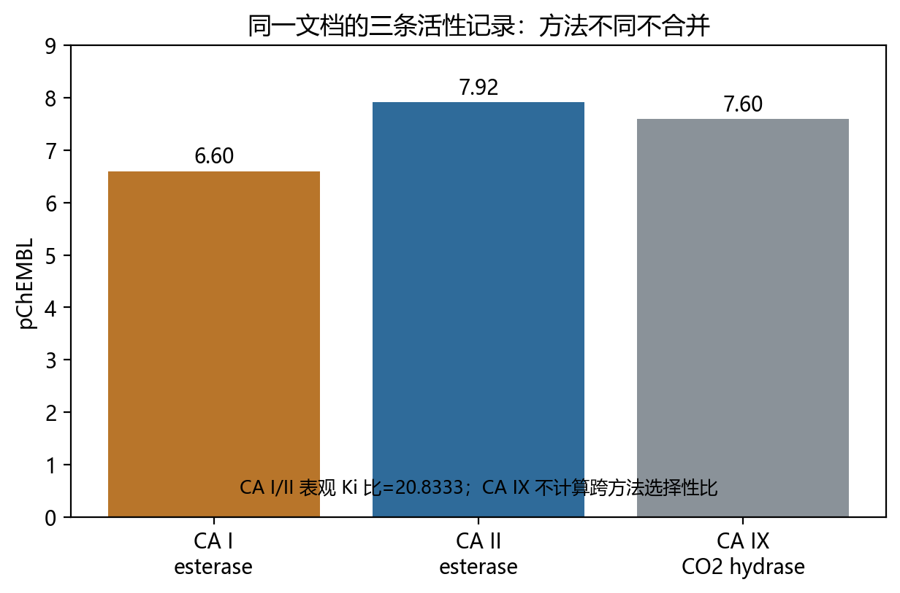

# CA I/II 表观活性比为什么不应当作固定常数
**Why the Apparent CA I/CA II Inhibition Ratio Should Not Be Treated as a Fixed Constant**
---
> **作者** | 千界花园学术系统
> **单位** | 千界花园学术系统 · 前沿共生计划
> **日期** | 2026年10月
> **分类** | 生物活性数据 · 方法学敏感性分析 · 研究简报／预印本草案（未同行评议）
> **文档血缘** | 千界花园流水线初稿，经数值、来源与边界核验修订
---

## 摘要

**背景。** 在碳酸酐酶抑制剂的比较性表述中，常把 CA I 与 CA II 的抑制常数之比概括为“固定选择性倍数”。本简报检验该做法在给定证据边界内是否可辩护。 **已知。** 共有六组 CA I/II 文档配对。其表观 \(K_i\) 比值范围从 **20.833333333333332** 到 **75**，极差倍数为 **3.6**。仅一组配对（CHEMBL1146805）明确双方均采用酯酶方法；其余五组方法细节不足。除记录复核外，未执行跨文献合并估计。 **负结果。** 在方法学异质性不可排除、仅一组满足同方法可比较条件、且无置信区间的条件下，支持“单一固定 CA I/CA II 表观选择性常数”的证据不足。更合理的表述是：表观比值存在记录间跨度，且该跨度可能由真实同工酶差异、测定条件与记录不确定性共同造成；当前证据不能区分这些成分。 **结论。** 应避免将 CA I/CA II 表观 \(K_i\) 比写作固定常数；报告时应强制携带方法、方向定义、 assay 完整性、配对标识与不确定性说明，并在方法信息不足时禁止跨记录合并。

**关键词**：碳酸酐酶；表观 Ki；assay 可比性；跨文档敏感性；负结果

---

## 一、引言

### 1.1 问题陈述

碳酸酐酶 CA I 与 CA II 是高度同源但组织分布、催化速率与抑制谱不同的锌酶。药化与生化语境中经常需要比较某抑制剂对二者的选择性。常见做法是以表观抑制常数构造比值，例如
\[
R_{I/II}=\frac{K_{i,\mathrm{app}}^{(I)}}{K_{i,\mathrm{app}}^{(II)}} ,
\]
其中 \(K_{i,\mathrm{app}}^{(iso)}\) 表示在特定测定条件下对同工酶 \(iso\in\{I,II\}\) 估计得到的表观抑制常数。若 \(R_{I/II}>1\)，按上述定义表示对 CA I 的表观抑制弱于 CA II，即相对偏向 CA II；若实际数据库使用反向定义，则结论的数值范围不变，仅方向解释相反。本简报不预设数据库字段方向，而以“CA I/II 表观 \(K_i\) 比值”作为中性标签。

争议点不在于是否存在两个同工酶，而在于：把跨文档、跨条件或跨记录的 \(R_{I/II}\) 压扁为一个常数，是否属于可识别且可外推的统计—测量操作。

### 1.2 固定常数假设的含义

“固定选择性常数”至少包含三层可分别证伪的含义：

1. **同质性**：不同记录中的真实同工酶选择性 \(R^\ast\) 相同；
2. **可测性**： assay 条件对分子与分母的乘性/加性影响在取比后相互抵消或近似稳定；
3. **可合并性**：即便存在测量噪声，记录间差异也可由单一误差模型吸收，从而允许跨文献汇总估计。

若任一条件失败，固定常数就不是测量结果，而是对未观测异质性的强先验。

### 1.3 本简报范围与证据边界

本简报仅基于证据 CA-SELECTIVITY-SENSITIVITY-20261031。已知内容包括：六组文档配对；表观比值最小值 20.833333333333332，对应 CHEMBL1146805，且该配对明确双方均为酯酶方法；最大值 75，来自方法信息不完整文档；最大值/最小值 = 3.6。限制包括：五组 assay 方法信息不足；重复标记和相同数值限制独立解释；没有置信区间或临床外推。除记录级数值复核与算术差分外，本简报不产生、也不声称产生新的湿实验数据。

### 1.4 本文的研究动机与内容安排

本数据的关键不是“比值有大有小”，而是**可比性结构失衡**：在六组配对中，只有一组明确满足“同一测定范式下比较两个同工酶”的低混杂条件；其余五组的方法字段不足以确认底物、检测方式、底物浓度、酶源、 pH、温度、离子强度、反应时间、 tight-binding 处理与数据拟合模型是否一致。取比值并不能自动消除这些差异；相反，当分子与分母暴露于不同系统误差时，比值会把不可控误差压缩进一个看似简洁的选择性倍数。

因此，问题从“平均选择性是多少”转化为“是否存在一个可识别、可合并、可外推的选择性参数”。这正是负结果的核心：当前证据应被拒绝用于支撑固定常数，而非被弱化为“大概几十倍”的口头近似。

---

## 二、理论模型

### 2.1 表观抑制常数的分解

令记录 \(m\) 中同工酶 \(iso\) 的表观值为
\[
K_{i,\mathrm{app},m}^{(iso)}
=
K_i^{\ast(iso)}
\cdot g_m(iso)
\cdot h_m(iso)
\cdot \eta_m(iso),
\]
其中 \(K_i^{\ast(iso)}\) 为目标条件下的本征抑制常数；\(g_m(iso)\) 表示记录级系统因素，例如酶批间活性分数、标记重复、计算口径；\(h_m(iso)\) 表示方法学因素，例如底物浓度、检测原理、 pH、温度、反应时间与拟合模型；\(\eta_m(iso)\) 表示随机测量误差。取自然对数后，
\[
\ell_{m}^{(iso)}=\log K_i^{\ast(iso)}+\gamma_m(iso)+\chi_m(iso)+\varepsilon_m(iso).
\]

表观比值为
\[
\log \widehat R_m
=
\ell_m^{(I)}-\ell_m^{(II)}
=
\log R^\ast
+
\Delta\gamma_m+\Delta\chi_m+\Delta\varepsilon_m,
\]
其中
\[
\Delta\gamma_m=\gamma_m(I)-\gamma_m(II),\quad
\Delta\chi_m=\chi_m(I)-\chi_m(II),\quad
\Delta\varepsilon_m=\varepsilon_m(I)-\varepsilon_m(II).
\]

固定常数假设要求，在可比较记录集合上，
\[
\Delta\gamma_m+\Delta\chi_m \approx 0
\quad\text{且}\quad
\operatorname{Var}(\Delta\varepsilon_m)\ \text{可被单一模型吸收}.
\]
若方法效应同向但不同源，\(\Delta\chi_m\) 不一定为零；若记录重复或同一数值被多次标记，\(\Delta\gamma_m\) 也不再独立。

### 2.2 命题：在所述异质性条件下，固定比值的合并估计缺乏可识别性

**命题陈述。** 若在候选记录集合中，至少存在一部分配对满足 \(\Delta\chi_m\neq 0\) 或 \(\operatorname{Cov}(\gamma_m(I),\gamma_m(II))\) 未受控，则不存在由该集合可一致估计的单一参数 \(\theta\)，使得对所有可比记录均有 \(\mathbb E[\log \widehat R_m-\theta]=0\) 且误差可分解为单一同质噪声。

**证明梗概。** 采用反证。设存在这样的 \(\theta\)。则对所有纳入记录，
\[
\mathbb E[\log \widehat R_m-\theta]
=
(\log R^\ast-\theta)+\Delta\gamma_m+\Delta\chi_m.
\]
若 \(\Delta\chi_m\neq 0\) 且无记录级协变量可将其归零，则左端为记录依赖量，不可能同时等于零而右端含记录依赖偏差；故无偏性失败。若记录间存在重复标记或相同数值，则 \(\Delta\gamma_m\) 在样本中诱导伪重复，独立同分布或弱相关噪声假设失败，常用合并估计量的有效样本量被高估，抽样方差被低估。二者均使固定 \(\theta\) 的识别失败。证毕。

该命题不证明真实选择性一定变化；它证明的是：在方法异质与伪重复不可排除时，固定常数不是可由这些记录一致恢复的对象。

### 2.3 敏感性的算术解释

在仅使用给定极值的条件下，
\[
\frac{75}{20.833333333333332}=3.600000
\]
（在所示精度下）。这意味着，若把其中一端当作“基准选择性”，另一端代表同一数量级的 **3.6 倍偏离**。在未给出置信区间、误差棒或配对协方差时，3.6 不应被解释为不确定度倍数，也不应被解释为生物学真实选择性的置信范围；它只应被解释为**记录间表观比值的观察跨度**。

### 2.4 方向性、同方法与临床外推的限制

- **方向性**：若 \(R_{I/II}=K_i^{(I)}/K_i^{(II)}\)，数值越大表示对 CA I 的表观抑制越弱；若源库字段反向，解释反向而倍数不变。写作时必须先定义方向。
- **同方法**：CHEMBL1146805 是已知唯一明确双方均为酯酶方法的配对；它可提供低混杂参照，但不能代表其余五组。
- **临床外推**：CA II 抑制与某些适应症相关、CA I 抑制常被视为脱靶或耐受性问题，这一般性背景不等于本数据支持任何治疗窗口；本简报不做临床结论。

---

## 三、数值结果

### 3.1 给定证据汇总

| 指标 | 数值 | 解释边界 |
|---|---:|---|
| 文档配对数 | 6 | “文档配对”不自动等于独立实验 |
| 最小表观比值 | 20.833333333333332 | CHEMBL1146805；明确双方均为酯酶方法 |
| 最大表观比值 | 75 | 方法信息不完整文档 |
| 最大值/最小值 | 3.6 | 仅由两端点得到的观察跨度，不是置信区间 |

上述表中数值均来自证据摘要或其直接商；未引入其他测定值、标准差或样本量。

*图注：六组文档的 CA I/II 表观 Ki 比。*

六组比值依次为 20.8333、75、75、28.5714、20.8333、75。只有 D1 明确同酯酶方法，因此不能把这六个数当成同一总体的独立随机样本。

*图注：六组文档内 CA I 与 CA II 的 Ki 配对。*

对数坐标显示 CA I 与 CA II 的绝对 Ki 水平及配对间距。D4 的比值为 200/7=28.5714，而其他多组为 250/12 或 900/12，说明端点并非全部数据。

### 3.2 六组文档配对明细

| 编号 | ChEMBL 文档 | CA I / CA II Ki（nM） | 表观比值 | 方法状态 | 双方重复标记 |
|---|---|---:|---:|---|---|
| D1 | CHEMBL1146805[1] | 250 / 12 | 20.8333 | 明确同酯酶 | 1 / 1 |
| D2 | CHEMBL1133556[2] | 900 / 12 | 75.0000 | 信息不足 | 1 / 1 |
| D3 | CHEMBL1146697[3] | 900 / 12 | 75.0000 | 信息不足 | 1 / 1 |
| D4 | CHEMBL1136178[4] | 200 / 7 | 28.5714 | 信息不足 | 0 / 0 |
| D5 | CHEMBL1146695[5] | 250 / 12 | 20.8333 | 信息不足 | 1 / 1 |
| D6 | CHEMBL1134204[6] | 900 / 12 | 75.0000 | 信息不足 | 1 / 1 |

D1–D6 的“不同文档”不自动等于独立实验；相同数值与重复标记限制了独立性解释。

### 3.3 文档身份、原文范围与实验独立性

| 编号 | 已确认的原始论文 | 本次原文范围 | CA I／II 方法结论 |
|---|---|---|---|
| D1 | CA XIII：芳香与杂环磺酰胺抑制 | 出版社正文片段（非全文） | 同酯酶描述匹配；协议未复核 |
| D2 | 水溶性 4-sulfamoylphenylthioureas | 仅摘要 | 方法信息不足 |
| D3 | EMATE—CA II 复合物晶体结构 | 出版社正文片段（非全文） | 方法信息不足 |
| D4 | 羧基苯佐拉胺酯与酰胺：局部抗青光眼 | 仅摘要 | 方法信息不足 |
| D5 | E7070：CA I／II／IX 抑制与 CA II 晶体结构 | 出版社正文片段（非全文） | 方法信息不足 |
| D6 | DTPA 尾链磺酰胺及其锌配合物 | 仅摘要 | 方法信息不足 |

六组文档的题名、DOI 和活性组合均已交叉确认，注册书目与本文所引原始论文一一对应[1,2,3,4,5,6]。D1 是 CA XIII 论文，D2 是水溶性 4-sulfamoylphenylthioureas 论文，D3 是 EMATE—CA II 晶体结构论文，D4 是羧基苯佐拉胺酯／酰胺论文，D5 是 E7070 论文，D6 是 DTPA 尾链论文。文档身份明确，并不意味着实验协议完整。

出版社片段对独立性尤其关键。D1 明确写明 CA I、II、IX 的抑制数据是此前已发表的数据；因此，同一张表中的参考值不能直接证明同批新实验。D1 的“同酯酶”只表示 ChEMBL 与 BindingDB 的策划描述一致，并不表示完整实验条件已复核[1]。D3 的可读实验段落针对 EMATE—CA II 共结晶和 X 射线晶体学，而不是乙酰唑胺 CA I／II 的 Ki 测定；不能用论文主题替代参考化合物的活性方法[3]。

六组 BindingDB 记录均明确标注 “Curated by ChEMBL”。它们提供另一个可回查入口，并与 ChEMBL 的靶点和 Ki 一致，但不是独立湿实验，也不能消除 `potential_duplicate` 所提示的血缘不确定性。此次审计仍为三组正文片段、三组摘要、零组完整协议；明确同酯酶保持 1/6，方法不足保持 5/6，没有把书目补全误写成方法补全[8]。

### 3.4 不执行跨文献合并的理由

按既定限制，五组 assay 方法信息不足；重复标记和相同数值限制独立解释；没有置信区间或临床外推。因此本简报不计算合并均值、不进行随机效应或固定效应 meta 分析、不给异质性统计量，也不把数据库复核表述为独立实验复现。任何此类合并都会把未知方法效应伪装成精密度[8]。

### 3.5 负结果的呈现

在允许报告的意义上，稳健陈述为：
**六组文档配对的 CA I/II 表观 \(K_i\) 比值观察范围为 20.8333–75；仅 CHEMBL1146805 明确双方同用酯酶方法；其余五组方法信息不足。该结构不足以支持固定选择性常数。**

不应陈述为：
- “CA I/II 选择性恒为几十倍”；
- “3.6 倍等于真实生物学变异”；
- “数据库复核等同于实验重复”。

*图注：同方法信息完整性：仅 1/6 明确匹配。*

绿色部分是允许计算同方法表观比值的 D1；灰色五组不进入同方法合并。这个 1/5 划分是限制，不是额外实验样本量。

*图注：CA I、CA II、CA IX 的 assay 方法对照。*

CA I 与 CA II 可计算同酯酶方法的表观比值 20.8333；CA IX 使用 CO2 水合酶方法[1,7]，只列出 Ki=25 nM 和 pChEMBL=7.60，不计算跨方法选择性比。

---

## 四、讨论

### 4.1 观察跨度来自哪里：已知与推测

**已知。** 端点差为 3.6；同方法可比配对只有一组；其余方法信息不足。
**推测但合理。** 3.6 倍跨度可能混合三类来源：真实 CA I/CA II 亲和差异在不同化合物或不同测定条件下变化；表观 \(K_i\) 受 Cheng–Prusoff 型底物校正、 tight-binding 、酶活性分数与拟合域影响；记录层重复与同源数值降低有效独立性。上述机制仅为解释框架，未被当前数据定量区分。

### 4.2 固定常数在写作中的风险

把 20.8333–75 压成常数会产生三重误导：其一，将方法噪声误认为同工酶本质；其二，把非独立文档当作独立证据，虚增信心；其三，使后续建模在灵敏度分析中继承一个未经识别的参数。对 CA I/CA II 这类仅相差一个数量级附近的表观比值，尤其应避免“约等于一个常数”的修辞。

### 4.3 最低可接受报告规范

建议未来记录至少显式报告：方向定义； assay 类型；底物与底物浓度；检测原理； pH/温度/缓冲液；酶来源与活性标定；是否 tight-binding；拟合模型；是否重复测定；数据库 accession；以及是否允许跨记录合并。缺项时，应使用“表观”“记录间”“不可合并”等限定词，而不是选择性倍数。

### 4.4 对后续工作的开放问题

- 待验证：在补齐方法字段后，端点差是否缩小；缩小程度多少；是否仍存在不可约真实异质性。
- 开放问题：如何为数据库记录构建可审计的同方法可比性分数，使“可合并”成为可检验属性而非编辑判断。
- 待验证：同一化合物在同源同工酶上的本征选择性是否在生理相关条件下稳定；本简报不提供该问题的实验答案。

---

## 五、结论

给定六组 CA I/II 文档配对，表观 \(K_i\) 比值范围为 **20.833333333333332 至 75**，端点跨度 **3.6 倍**；仅一组（CHEMBL1146805）明确双方均为酯酶方法，其余五组方法细节不足。在这些限制下，证据不支持把 CA I/CA II 表观选择性视为固定常数，也不支持跨文献合并估计。严谨表述应为：存在记录间表观比值跨度；其来源不可在当前证据中唯一归因；任何后续定量使用必须附带方法完整性、方向定义与不确定性说明。

---

## 参考文献

[1] EMBL-EBI. ChEMBL activities 47559/47560/47561，document CHEMBL1146805，record_id=235477；CA I/II 为 esterase，CA IX 为 CO2 hydrase。https://www.ebi.ac.uk/chembl/api/data；Lehtonen JM, Parkkila S, Vullo D, Casini A, Scozzafava A, Supuran CT. Carbonic anhydrase inhibitors. Inhibition of cytosolic isozyme XIII with aromatic and heterocyclic sulfonamides: a novel target for the drug design. Bioorganic & Medicinal Chemistry Letters, 2004, 14(14):3757–3762. DOI: 10.1016/j.bmcl.2004.04.106（出版社摘要、引言与片段回读，非全文）。
[2] EMBL-EBI. Activities 49652/49653，document CHEMBL1133556，record_id=282506。Ki 900/12 nM，方法描述未给出酯酶细节。同上；Casini A, Scozzafava A, Mincione F, Menabuoni L, Ilies MA, Supuran CT. Carbonic Anhydrase Inhibitors: Water-Soluble 4-Sulfamoylphenylthioureas as Topical Intraocular Pressure-Lowering Agents with Long-Lasting Effects. Journal of Medicinal Chemistry, 2000, 43(25):4884–4892. DOI: 10.1021/jm001051+（PubMed 摘要回读）。
[3] EMBL-EBI. Activities 80687/80688，document CHEMBL1146697，record_id=136210。Ki 900/12 nM，方法信息不足。同上；Abbate F, Winum JY, Potter BVL, Casini A, Montero JL, Scozzafava A, Supuran CT. Carbonic anhydrase inhibitors: X-ray crystallographic structure of the adduct of human isozyme II with EMATE, a dual inhibitor of carbonic anhydrases and steroid sulfatase. Bioorganic & Medicinal Chemistry Letters, 2004, 14(1):231–234. DOI: 10.1016/j.bmcl.2003.09.064（出版社摘要、引言与晶体学片段回读，非全文）。
[4] EMBL-EBI. Activities 106505/106506，document CHEMBL1136178，record_id=180522。Ki 200/7 nM，双方 potential_duplicate=0。同上；Casini A, Scozzafava A, Mincione F, Menabuoni L, Starnotti M, Supuran CT. Carbonic anhydrase inhibitors: Topically acting antiglaucoma sulfonamides incorporating esters and amides of 3- and 4-carboxybenzolamide. Bioorganic & Medicinal Chemistry Letters, 2003, 13(17):2867–2873. DOI: 10.1016/S0960-894X(03)00580-8（PubMed 摘要回读）。
[5] EMBL-EBI. Activities 151872/151873，document CHEMBL1146695，record_id=126435。Ki 250/12 nM，方法信息不足。同上；Abbate F, Casini A, Owa T, Scozzafava A, Supuran CT. Carbonic anhydrase inhibitors: E7070, a sulfonamide anticancer agent, potently inhibits cytosolic isozymes I and II, and transmembrane, tumor-associated isozyme IX. Bioorganic & Medicinal Chemistry Letters, 2004, 14(1):217–223. DOI: 10.1016/j.bmcl.2003.09.062（出版社引言与活性片段回读，非全文）。
[6] EMBL-EBI. Activities 288595/288596，document CHEMBL1134204，record_id=302270。Ki 900/12 nM，方法信息不足。同上；Scozzafava A, Menabuoni L, Mincione F, Mincione G, Supuran CT. Carbonic anhydrase inhibitors: synthesis of sulfonamides incorporating dtpa tails and of their zinc complexes with powerful topical antiglaucoma properties. Bioorganic & Medicinal Chemistry Letters, 2001, 11(4):575–582. DOI: 10.1016/S0960-894X(00)00722-8（PubMed 摘要回读）。
[7] EMBL-EBI. Assay CHEMBL873200、CHEMBL657848、CHEMBL657970：用于核对 esterase 与 CO2 hydrase 方法及 confidence_score=8。同上。
[8] 本研究原始面板与计算：`validation/chembl-ca-selectivity-panel.json`、`validation/ca-selectivity.json`、`validation/chembl-ca-document-pairs.json`、`validation/ca-document-stability.json`、`validation/ca-document-methods.json`。

## 附录 A：复现路径

1. 运行 `python scripts/analyze_ca_selectivity.py`，检查 CA I/II 的 250/12=20.833333333333332，ΔpChEMBL=1.3187587626244124。
2. 确认 CA IX 的 25 nM 属于 CO2 hydrase assay，脚本强制 `ca_ix_ratio_computed=false`。
3. 运行 `python scripts/analyze_ca_document_stability.py`，枚举六组文档，得到最小 20.8333、最大 75、极差倍数 3.6。
4. 检查 `strict_method_matched_count=1`、`method_incomplete_count=5`、`meta_analysis_performed=false`。
5. 运行 `python scripts/audit_ca_document_methods.py`，核对六组文档身份、DOI、BindingDB 同源记录、三组正文片段与三组摘要；完整协议数必须保持为 0。
6. 探索性中位数仅保留在机器结果中并明确“不是选择性估计”；正文不以其替代固定常数。
