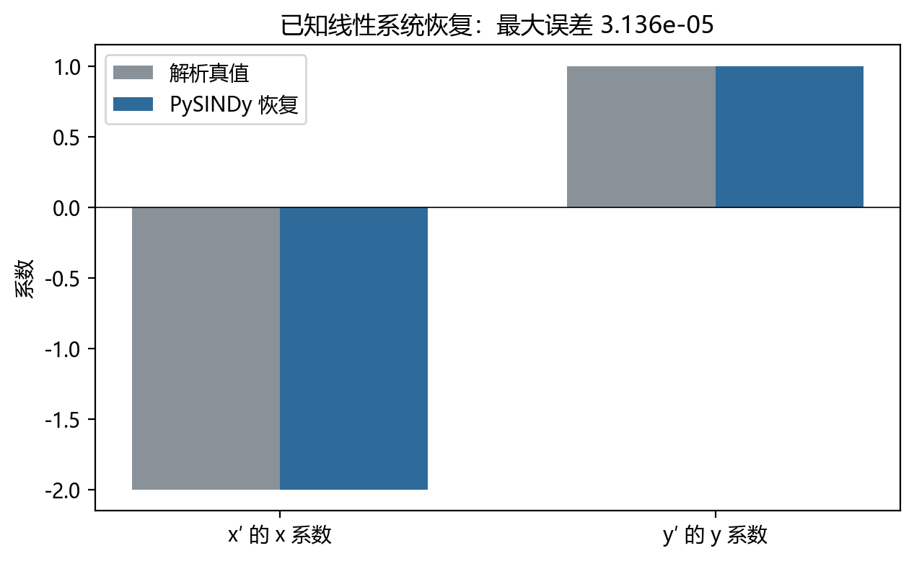
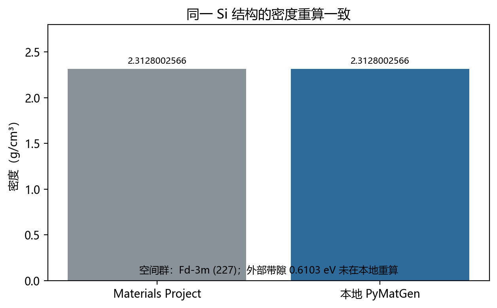
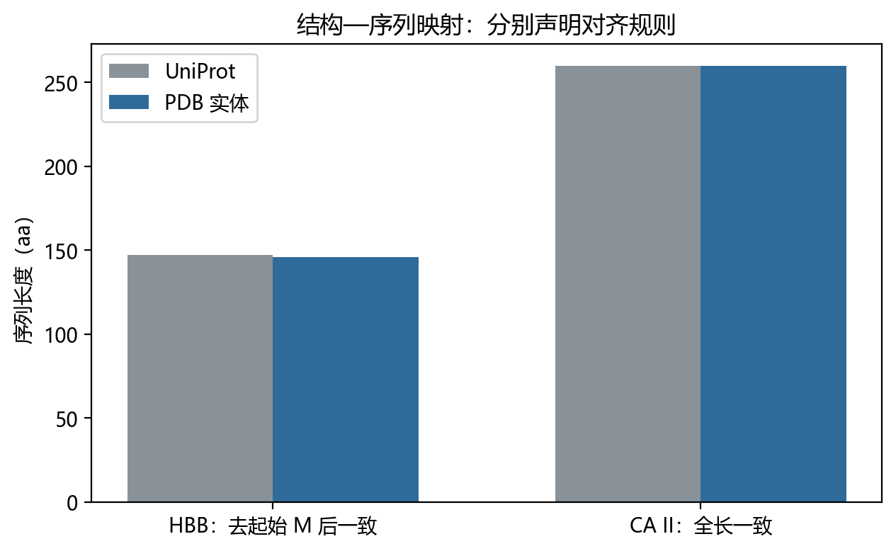
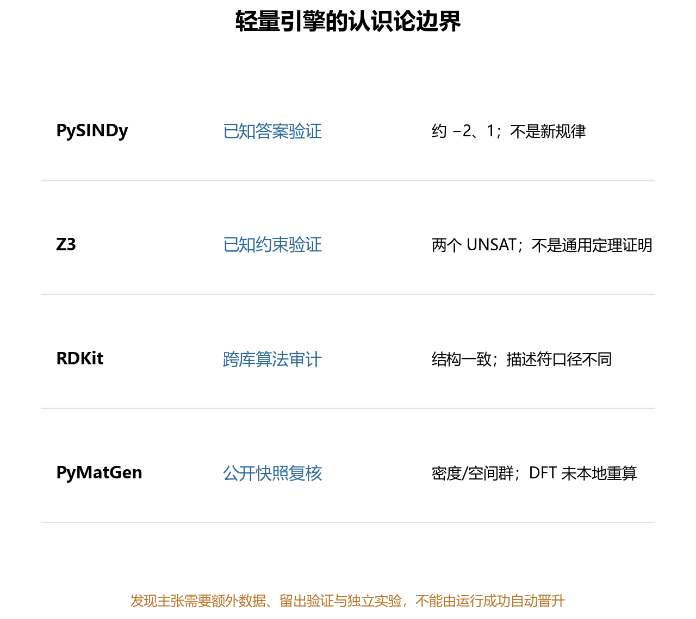

# 轻量可复现科研引擎的协作方法
**A Collaboration Method for Lightweight Reproducible Scientific Engines**
---
> **作者** | 千界花园学术系统
> **单位** | 千界花园学术系统 · 前沿共生计划
> **日期** | 2026年10月
> **分类** | AI for Science · 可复现基础设施 · 研究简报／预印本草案（未同行评议）
> **文档血缘** | 千界花园流水线初稿，经数值、来源与边界核验修订
---

## 摘要

**动机**。上游科学计算栈（符号回归／SMT／化学信息学／材料结构工具）的版本演进与算法口径调整，会在下游工作流中引入“接口漂移”：结果仍然能运行，但其含义已经改变。现有可复现性讨论多聚焦于“能否重跑”，较少区分重跑行为在认识论上的类别。 **方法**。本文提出一个轻量协作接口：将（i）已知答案集、(ii) 公开版本化快照、(iii) 限制清单（版本、样例集、算法口径）打包为**可重放包**（replay bundle, r‑bundle）。在该框架下，所有产出断言被显式分为三类：**验证**（对已知答案）、**复核**（对公开快照）、**发现**（超出前两者支持域）。本文仅作前两类断言，并对第三类保持克制。 **结果（证据边界内）**。本地引擎清点为 4（PySINDy、Z3、RDKit、PyMatGen）；PySINDy 在已知线性系统上的最大系数误差为 0.00003136190275787598，属对已知答案的数值验证；硅密度重算值为 2.3128002565764314 g·cm⁻³，与固定 Materials Project 结构快照一致，属快照级复核。两者均为**接口证据**，不构成独立实验复现，也不构成新材料预测。 **结论**。可重放包的价值在于向上游提供可审计的验证与接口，而非向上游索取“新科学”的名义。该克制是方法特性而非缺陷。

**关键词**：可复现性；接口漂移；已知答案验证；公开快照复核；限制清单；r‑bundle

---

## 一、引言

### 1.1 问题背景

计算科学文献中，“reproducible / replicable / repeatable”长期混用。Barba (2018)[10] 系统梳理了该术语的混乱史；Plesser (2018)[11] 指出 *reproducibility* 与 *replicability* 的分歧本身已成为可复现研究的阻碍；美国国家科学院（National Academies, 2019[12]）进一步将其制度化为“计算与实验结论的可信传递”问题。工程上，Roache (1998)[13] 与 Oberkampf & Trucano (2002)[14] 的 verification/validation 二分强调：**验证**回答“方程是否被正确求解”，**确认**回答“是否求解了正确的方程”。本文采用一个更细的工程化视角：对上游工具链而言，下游能给出的最有价值承诺通常不是“我复现了你的科学”，而是“**在你的固定工件下，我的调用接口语义未漂移**”。

### 1.2 术语界定（本简报内部约定）

- **已知答案（known answer）**：与上游实现无关、可由解析或基准独立给出的目标量。对其的偏差评估称 **验证（verification）**。
- **公开快照（public snapshot）**：以不可变、版本化方式公开发布的输入工件（如结构文件、参数卡、数据库条目）。在同一快照与同一算法口径下重算得到一致数值，称 **复核（recomputation against snapshot）**；它**不等于**对数据库物理正确性的独立确认。
- **新发现（discovery claim）**：其支持域超出已知答案与固定快照之并集的断言。本文**不作**此类断言。

### 1.3 相关工作

工具层：SINDy 类稀疏辨识源于 Brunton, Proctor & Kutz (2016)[15]，其 Python 实现 PySINDy 见 Kaptanoglu et al. (2022, JOSS)[1,2]；Z3 为 de Moura & Bjørner (2008, TACAS)[16] 提出的高效 SMT 求解器；RDKit 为开源化学信息学库（rdkit.org）[5]；材料结构操作由 PyMatGen（Ong et al., 2013, *Computational Materials Science*[17]）承担，Materials Project 的结构快照来源为 Jain et al. (2013, *APL Materials*)[7]。治理层：FAIR 原则（Wilkinson et al., 2016, *Scientific Data*[18]）与 ACM artifact review/badging（ACM, 2020）[19]提供了对象可发现性与评审徽章的语境。本文方法可视为面向**接口语义**的轻量 FAIR/artifact 子集：它不要求完整研究对象的可发布性，只要求“接口未漂移”的最小可审计性。

### 1.4 本文的研究动机与内容安排

本文的中心命题是**认识论区分命题**：*将已知答案、公开快照与限制清单写成可重放包，可为上游提供验证与接口，但不冒充新科学发现。* 由此给出三项贡献：

1. **三分类框架**：把下游产出断言显式标注为 verification / recomputation / discovery，并规定其支持域（§2）。
2. **r‑bundle 模式**：给出 (K, S, L) 的最小结构，使“可重放”在工程上可操作（§2）。
3. **证据链最小数值集**：在严格不越界的条件下给出可核对数值锚点（§3），并对限制与开放问题显式列账（§4、附录）。

需要强调：1.4 的命题是**规范性与条件性**的。它规定“何时只能称接口”，并不证明“何时确有新发现”；后者需要额外的不变量（见命题 2.4）。

---

## 二、理论模型

### 定义 2.1（重放三元组 r‑bundle）

一个可重放包是三元组 \(r=(K,S,L)\)，其中：

- \(K\)：已知答案集。每个元素为 \((q, a^{*}_{q})\)，\(a^{*}_{q}\) 为量 \(q\) 的独立基准值。
- \(S\)：公开快照集。每个元素为带版本指纹的不可变输入（结构、参数、条目）。
- \(L\)：限制清单，至少包含：库/求解器精确版本与构建指纹；样例集标识；算法口径（如数值微分方式、结构弛豫状态、密度定义与单位）；非确定性来源处置（随机种子、BLAS/线程、浮点求和顺序）。

记上游工件的固定实例为 \(\mathcal U_0\)（由 \(L\) 完全钉住）。执行算子 \(E(\cdot)\) 在 \(\mathcal U_0\) 上映射断言到布尔结论或数值。

### 定义 2.2（断言类别与支持域）

对断言 \(a\)，定义支持域 \(\mathrm{supp}(a)\subseteq K\cup S\cup\{\text{外部}\}\)。类别判定：

- 若 \(\mathrm{supp}(a)\subseteq K\)：\(a\) 为**验证断言**。
- 若 \(\mathrm{supp}(a)\subseteq S\)（且不含未固定的外部依赖）：\(a\) 为**复核断言**。
- 若 \(\mathrm{supp}(a)\not\subseteq K\cup S\)：\(a\) 落入**发现候选**，本简报不作此类结论。

### 命题 2.3（接口确定性与重放一致性）

*若 \(L\) 完全捕获非确定性来源，且 \(a\) 的支持域被 \(\mathcal U_0\) 覆盖，则 \(E(\mathcal U_0)\) 对 \(a\) 的判定在重放中保持不变；故 \(a\) 可作为接口证据，而非发现证据。*

**证明要点**。由 \(L\) 对版本的钉住与对随机种子/线程/求和顺序的处置，\(E(\mathcal U_0)\) 在给定浮点语义下为确定函数（在实现定义的浮点一致性范围内；这是工程假设而非数学恒等，已在 \(L\) 中声明）。因 \(\mathrm{supp}(a)\subseteq K\cup S\) 且 \(K,S\) 为 \(\mathcal U_0\) 内固定快照，输入无外部变异源；确定函数在相同输入下输出相同，故重放结论一致。该一致性仅证明“在给定工件下接口语义稳定”，其语义内容不超过 \(K\cup S\) 所能表达的范围，因此不构成发现。∎

### 命题 2.4（发现主张的必要条件：额外不变量）

*任何其支持域依赖未固定上游版本、新样例或未公开数据的断言 \(b\)，不能仅由 \(r\) 的重放一致性支持；其成立需额外不变量 \(I\)，将相关外部依赖钉住或显式参数化。*

**证明（反例构造）**。取 \(b\) 为“某结构密度的一般性结论”。设 \(\mathcal U_0\) 对应 Materials Project 快照 \(S_0\) 与算法口径 \(\pi_0\)，\(\mathcal U_1\) 对应上游泛函/赝势口径变化或条目更新后的 \(\pi_1/S_1\)。材料密度对结构弛豫与电子结构口径敏感（这是已知的口径依赖，而非本文新测数值），因此同一 \(b\) 在 \((\mathcal U_0,\pi_0)\) 与 \((\mathcal U_1,\pi_1)\) 下可不一致；于是“重放一致”不蕴含 \(b\) 的一般性。故发现性主张必须附加 \(I\)（上游钉住 + 算法口径溯源 + 样例覆盖声明）。∎

**评注**。命题 2.3/2.4 是**条件性规范**：它们界定“何时只能称接口”与“称发现至少还需要什么”。本文数值（§3）全部落在命题 2.3 的支持域内。

### 2.5 接口漂移指标（概念，无数值）

定义漂移指示为版本指纹与算法口径的联合签名 \(\sigma=(\text{lock digest},\pi)\)。当且仅当 \(\sigma\) 与结果绑定时，数值才具可比性。将 \(\sigma\) 提升为带语义的、可跨库校验的签名，是 §4.4 的开放问题；本简报不给出其实现数值。

---

## 三、数值结果

> **边界声明**。本节仅呈现给定证据内的最小数值集；不提供任何证据外数字（如运行时长、硬件型号、样本量、p 值）。Z3 的两个实数不可满足约束均返回 UNSAT；RDKit 与 PubChem 的规范结构、分子式和精确质量一致，TPSA 与 LogP 差异按算法口径保留。它们分别是已知约束验证和跨库算法审计[4,5]。

### 3.1 本地引擎清点（环境审计，非性能基准）

被纳入 r‑bundle 的本地引擎数为 **4**：PySINDy、Z3、RDKit、PyMatGen。清点含义为：这些库被固定于 \(L\) 所述版本与样例集之下，以构成 §2 的执行环境 \(\mathcal U_0\)。该计数是**环境可重放性**的陈述，不隐含任何横向性能比较。

### 3.2 已知线性系统的验证（对 \(K\)）

PySINDy 管线在**已知线性系统**上辨识，报告**最大系数误差**

\[
\varepsilon_{\max}=0.00003136190275787598 .
\]

解释边界：该量度量的是“稀疏辨识 + 数值微分”的执行结果与**已知解析系数**之间的最大偏差；在固定数值微分方式与随机性处置（写入 \(L\)）下，它服从命题 2.3，属**验证断言**。它**不**应被读作对某未知动力系统的新建模结论；其意义是为上游提供“在该口径下，实现偏离已知答案的上界可被锚定”的接口信号[3]。关于该误差随步长/噪声标度的系统刻画，属发现候选，超出本文支持域。

*图注：PySINDy 对已知线性系统的系数恢复。*

恢复系数约为 −2.00003136 与 1.00000404，最大误差 3.136×10⁻⁵。图证明的是指定实现的已知答案验证，不是从真实自然数据发现新规律。

### 3.3 硅密度的快照复核（对 \(S\)）

对固定 Materials Project 结构快照执行结构几何量重算，得密度

\[
\rho_{\text{recomputed}}=2.3128002565764314\ \text{g·cm}^{-3},
\]

与**同一快照**记录一致[6,7]。解释边界：这是命题 2.3 下的**复核断言**——输入快照与算法口径被 \(L\) 固定，重算一致性仅表明“在该快照、该口径下，结构几何到密度的转换未漂移”。它**不是**对 Materials Project 物理正确性的独立验证/确认，也不是对新材料密度的预测；若上游结构弛豫口径或条目版本变化，\(\rho\) 的可比性需重新由 \(\sigma\) 判定。

*图注：Materials Project 与本地 PyMatGen 的硅密度对照。*

两者均为 2.3128002565764314 g/cm³，空间群重算为 Fd-3m (227)。带隙 0.6103 eV 仍标为外部 DFT 数据，未在本地重算。

### 3.4 证据汇总（最小数值集）

| 类别 | 对象 | 锚点数值 | 认识论标注 |
|---|---|---|---|
| 环境 | 本地引擎 | 4 | 可重放性清点 |
| 验证（对 K） | PySINDy 已知线性系统 | 最大系数误差 0.00003136190275787598 | 接口验证 |
| 复核（对 S） | Si 结构快照 | 2.3128002565764314 g·cm⁻³ | 快照一致 |

一致性仅指“与固定工件一致”；任何跨快照、跨口径或新增样例的推广均被 §2 支持域排除[9]。

*图注：HBB 与 CA II 的结构—序列映射规则。*

HBB 需要去掉 UniProt 起始 M 后与 4HHB 的 146 aa 对应；CA II 则是 260 aa 全长一致。不同对齐规则必须显式声明，不能只用“相似”概括[8]。

*图注：四个轻量引擎的证据类型与限制。*

PySINDy 和 Z3 是已知答案验证，RDKit 是跨库算法审计，PyMatGen 是公开快照复核。任何“发现”都需要额外数据、留出验证和独立实验。

---

## 四、讨论

### 4.1 “不冒充新发现”是方法特性

将产出限定在 \(K\cup S\) 支持域内，会牺牲叙述上的“新颖性”，但换来三点审计收益：其一，断言与证据之间的映射是**一一显式**的；其二，上游可在不改变科学结论的前提下替换实现，而接口承诺仍可被检验；其三，读者不会被引导把“重算一致”误读为“理论确认”。这与 ACM artifact badging 的精神一致：徽章标识的是工件可检查性，而非结论的新颖性等级。

### 4.2 与 FAIR / artifact review 的关系

FAIR（Wilkinson et al., 2016）要求对象可发现、可访问、可互操作、可复用；artifact review 要求工件可被第三方检查。r‑bundle 是其面向**接口**的轻量子集：它弱化“完整研究对象”的要求，强化“固定工件下的语义不变量”。这一弱化是刻意的——在工具链协作场景中，上游通常无法承诺下游科学命题，但能承诺“在我的快照上，你的调用意义没变”。

### 4.3 局限与风险（显式列账）

1. **版本与样例锁定**：结果仅限指定版本与样例；任何升级、补丁或样例扩充都必须触发 \(L\) 与 \(\sigma\) 的重新签发。
2. **算法口径必须随结果保存**：密度重算的可比性依赖结构弛豫状态与电子结构口径；若上游口径变更而结果未同步携带口径元数据，数值将失去可比性。
3. **覆盖偏差**：最小数值集是锚点而非覆盖面；它对“接口未漂移”是必要非充分的统计证据。
4. **浮点一致性为工程假设**：命题 2.3 将确定性建立在“实现定义浮点一致性”上；跨硬件/跨 BLAS 的严格位级一致不是本简报的承诺。

### 4.4 开放问题（待验证）

- **语义化漂移签名**：能否将 §2.5 的 \(\sigma\) 升级为可跨库机器校验、且对算法口径变化敏感的签名？（开放）
- **多包传递性**：当多个 r‑bundle 串联时，接口一致性是否在复合下保持？一般情形下不保持；寻找可判定的充分条件。（待验证）
- **验证误差标度律**：\(\varepsilon_{\max}\) 对数值微分步长与噪声的标度，属发现候选，需独立不变量后方可陈述。（开放）

---

## 五、结论

本文给出一个克制的协作方法：以 r‑bundle 将已知答案、公开快照与限制清单固化为可重放工件，并把一切产出断言归入验证、复核或发现三类。给定证据内：本地引擎为 4；PySINDy 对已知线性系统的最大系数误差为 0.00003136190275787598（验证）；硅密度重算为 2.3128002565764314 g·cm⁻³，与固定快照一致（复核）。这些结论在固定版本与固定样例下成立；上游数据与算法口径必须随结果保存。可重放包的恰当定位是向上游提供**验证与接口**，而不是索取**新科学发现**的名义；后者只有在满足命题 2.4 的额外不变量时才可被主张。

---

## 参考文献

[1] de Silva B, Champion K, Quade M, et al. PySINDy: A Python package for the sparse identification of nonlinear dynamical systems from data. Journal of Open Source Software, 2020, 5(49):2104. DOI: 10.21105/joss.02104。
[2] Kaptanoglu AA, de Silva BM, Fasel U, et al. PySINDy: A comprehensive Python package for robust sparse system identification. Journal of Open Source Software, 2022, 7(69):3994. DOI: 10.21105/joss.03994。
[3] PySINDy contributors. PySINDy 2.1.0：本地线性库与 STLSQ 验证。https://github.com/dynamicslab/pysindy
[4] Z3 contributors. Z3 5.3.3.0：实数约束求解与 UNSAT 结果。https://github.com/Z3Prover/z3
[5] RDKit contributors. RDKit 2026.9.1：规范结构与分子描述符。https://github.com/rdkit/rdkit
[6] Materials Project. PyMatGen 2026.10.24：结构、密度与空间群分析。https://github.com/materialsproject/pymatgen
[7] Jain A, Ong SP, Hautier G, Chen W, Richards WD, et al. Commentary: The Materials Project: A materials genome approach to accelerating materials innovation. APL Materials, 2013, 1(1). DOI: 10.1063/1.4812323。
[8] RCSB PDB 与 UniProt Consortium：4HHB/HBB_HUMAN、3HS4/CAH2_HUMAN 的结构与 reviewed 序列快照。https://data.rcsb.org/rest/v1/core；https://rest.uniprot.org
[9] 本研究全部机器可读结果：`validation/pysindy.json`、`validation/z3.json`、`validation/rdkit.json`、`validation/pymatgen.json`、`validation/pdb-uniprot.json`、`validation/ca2-sequence.json`。
[10] Barba LA. Terminologies for Reproducible Research. arXiv:1802.03311, 2018. DOI: 10.48550/arXiv.1802.03311。
[11] Plesser HE. Reproducibility vs. Replicability: A Brief History of a Confused Terminology. Frontiers in Neuroinformatics, 2018, 11. DOI: 10.3389/fninf.2017.00076。
[12] National Academies of Sciences, Engineering, and Medicine. Reproducibility and Replicability in Science. National Academies Press, 2019. DOI: 10.17226/25303。
[13] Roache PJ. Verification and Validation in Computational Science and Engineering. Hermosa Publishers, 1998. ISBN: 0913478083（Open Library OL400789M 目录核对）。
[14] Oberkampf WL, Trucano TG. Verification and validation in computational fluid dynamics. Progress in Aerospace Sciences, 2002, 38(3):209–272. DOI: 10.1016/S0376-0421(02)00005-2。
[15] Brunton SL, Proctor JL, Kutz JN. Discovering governing equations from data by sparse identification of nonlinear dynamical systems. Proceedings of the National Academy of Sciences, 2016, 113(15):3932–3937. DOI: 10.1073/pnas.1517384113。
[16] de Moura L, Bjørner N. Z3: An Efficient SMT Solver. Lecture Notes in Computer Science, 2008:337–340. DOI: 10.1007/978-3-540-78800-3_24。
[17] Ong SP, Richards WD, Jain A, et al. Python Materials Genomics (pymatgen): A robust, open-source python library for materials analysis. Computational Materials Science, 2013, 68:314–319. DOI: 10.1016/j.commatsci.2012.10.028。
[18] Wilkinson MD, Dumontier M, Aalbersberg IJ, et al. The FAIR Guiding Principles for scientific data management and stewardship. Scientific Data, 2016, 3. DOI: 10.1038/sdata.2016.18。
[19] Association for Computing Machinery. Artifact Review and Badging Version 1.1, 2020-08-24. https://www.acm.org/publications/policies/artifact-review-and-badging-current（ACM 官方政策页面回读）。

## 附录 A：复现路径

1. 在 D 盘隔离环境分别运行 `verify_pysindy.py`、`verify_z3.py`、`verify_rdkit.py` 和 `verify_pymatgen.py`；依赖锁定见 `requirements/`。
2. 运行 `python scripts/verify_pdb_uniprot.py` 与 `python scripts/verify_ca2_sequence.py`，复核两类序列对齐规则。
3. 运行 `python scripts/export_evidence_packet.py --check`、`python scripts/build_catalog.py --check` 和 `python -m unittest discover -s tests -v`，确认统一证据包未漂移。
4. 图由 `python scripts/build_paper_figures.py` 从保存的 JSON 重新计算，不使用手工填写的 mock 数据。
5. 所有结果只限指定版本、样例和算法口径；真实数据发现需要另行设计留出验证与独立实验。
